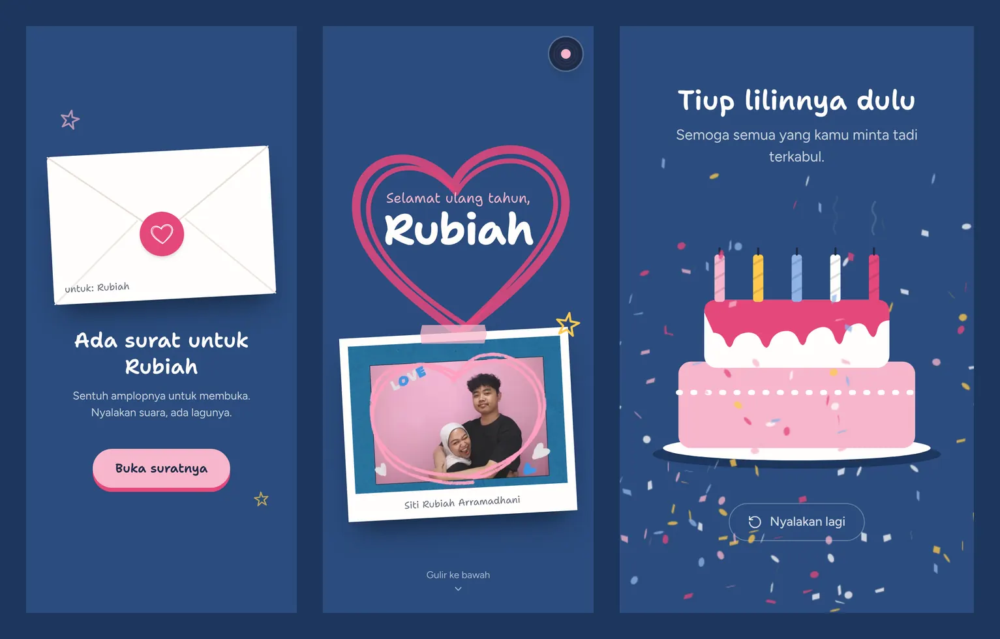
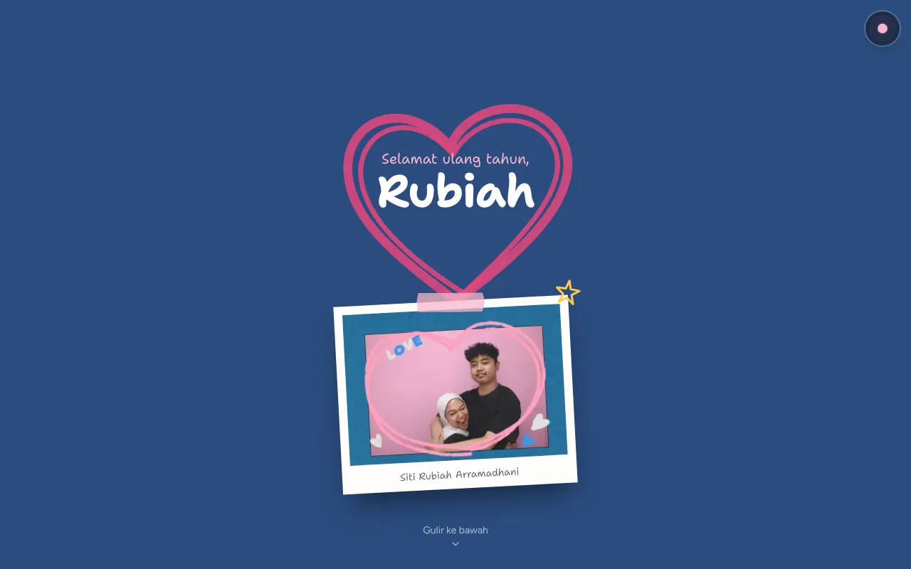
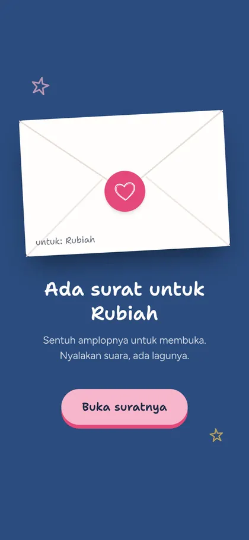
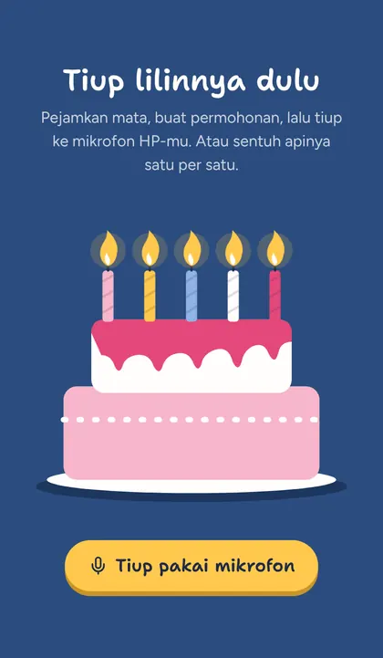
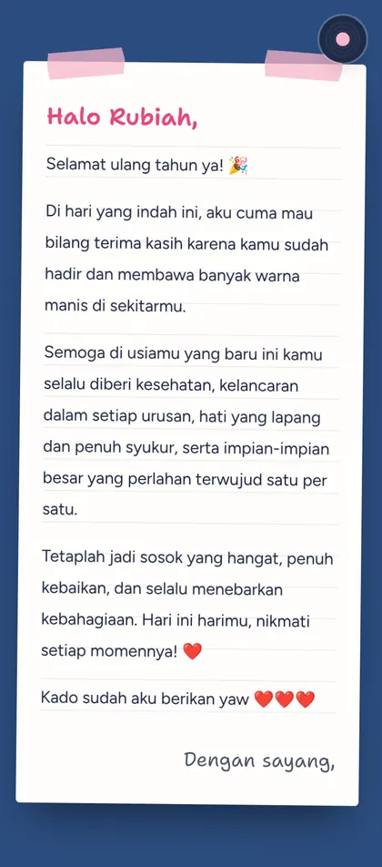
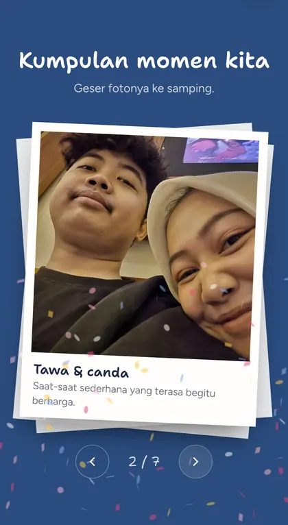

# HBD Guys

> Kartu ucapan ulang tahun digital untuk Rubiah: tiup lilin pakai mikrofon, surat, dan foto kenangan.



| | |
| --- | --- |
| **Status** | 🟢 Live |
| **Platform** | Web (mobile-first) |
| **Stack** | React 19, Vite, Tailwind CSS v4, Framer Motion |
| **Versi** | v1.1.1 — 18 Okt 2026 |

## Tentang

Kartu ucapan ulang tahun berbentuk website satu halaman yang dibuka lewat link. Desainnya mengikuti foto photobooth pertama: latar biru denim dengan coretan hati pink. Isinya sederhana, tapi tiap bagian punya satu interaksi kecil supaya terasa personal.

## Fitur utama

- **Amplop pembuka** — sentuh amplop untuk membuka kartu sekaligus memutar lagu
- **Tiup lilin sungguhan** — tiup ke mikrofon HP untuk mematikan lilin satu per satu, atau sentuh apinya
- **Surat di kertas bergaris** — surat personal dengan tanda tangan pengirim
- **Tumpukan foto polaroid** — geser (swipe) untuk melihat 7 foto kenangan
- **Kartu gosok** — gosok dengan jari untuk melihat pesan kado
- **Balas lewat WhatsApp** — tombol balasan otomatis bila nomor diisi di config
- **Pratinjau link** — gambar dan judul muncul saat link dibagikan di WhatsApp

## Screenshots

| Desktop | |
| --- | --- |
|  | |

<p>
  
  
  
  
  
</p>

## Tech stack

| Bagian | Teknologi |
| --- | --- |
| UI | React 19 + TypeScript |
| Build | Vite 8 |
| Styling | Tailwind CSS v4 (token warna di `src/index.css`) |
| Animasi | Framer Motion, canvas-confetti |
| Font | Shantell Sans, Figtree (self-host via Fontsource) |
| Hosting | Vercel |

## Menjalankan di lokal

```bash
npm install
npm run dev
```

<details><summary><b>Mengganti isi kartu</b></summary>

Semua teks dan foto ada di `src/config.ts`:

| Nama | Wajib | Keterangan |
| --- | --- | --- |
| `name`, `nickname` | ✅ | Nama lengkap dan panggilan penerima |
| `sender` | | Nama pengirim untuk tanda tangan surat |
| `whatsapp` | | Nomor WA pengirim (mis. `6281234567890`) untuk tombol balasan |
| `candles` | ✅ | Jumlah lilin di kue |
| `letter`, `gift`, `wishes` | ✅ | Isi surat, pesan kado, dan doa |
| `photos` | ✅ | Daftar foto di `public/` beserta keterangannya |

Foto sebaiknya WebP dengan sisi terpanjang maksimal 1400 px.

</details>

<details><summary><b>Struktur folder</b></summary>

```text
src/
  config.ts            isi kartu
  App.tsx              susunan halaman + musik
  components/          CoverScreen, Hero, CakeSection, Letter, PhotoStack, ScratchGift, Wishes, Ending
  hooks/useBlowDetector.ts   deteksi tiupan dari mikrofon
  lib/confetti.ts
public/                foto, music.mp3, og.jpg
docs/screenshots/      screenshot untuk README
```

</details>

<details><summary><b>Script npm</b></summary>

| Nama | Keterangan |
| --- | --- |
| `npm run dev` | Server lokal di port 4000 |
| `npm run dev:https` | Server lokal https, untuk tes mikrofon dari HP lewat Wi-Fi |
| `npm run build` | Cek tipe + build produksi |
| `npm run lint` | ESLint |
| `npm run preview` | Pratinjau hasil build |

</details>

## Deploy

1. Push ke GitHub.
2. Import repo di Vercel (preset Vite, tanpa environment variable).
3. Setelah dapat domain, ubah `og:image` di `index.html` menjadi URL lengkap (mis. `https://domain-kamu/og.jpg`) agar pratinjau WhatsApp muncul.
4. Buka link di HP dan coba tiup lilin (mikrofon hanya jalan di HTTPS).

## Roadmap

- [x] Tiup lilin lewat mikrofon
- [x] Galeri foto model tumpukan polaroid
- [x] Kartu gosok untuk kado
- [x] Pratinjau link WhatsApp
- [ ] Isi `sender` dan `whatsapp` di config
- [ ] Hitung mundur sebelum hari-H (opsional)

## Changelog

| Versi | Tanggal | Perubahan |
| --- | --- | --- |
| v1.1.1 | 18 Okt 2026 | Perbaikan mikrofon: AudioContext dibuat saat disentuh (fix Safari/Chrome HP), ambang tiupan adaptif, pesan error jelas, mode `dev:https` |
| v1.1.0 | 18 Okt 2026 | Desain ulang tema photobooth, tiup lilin via mikrofon, tumpukan foto, kartu gosok, balasan WhatsApp, kompres aset 11 MB → 4 MB |
| v1.0.0 | 18 Okt 2026 | Versi awal: cover, kue, surat, kado, galeri, doa |

## Catatan

- **Mikrofon butuh HTTPS** — browser memblokir mikrofon di `http://192.168.x.x`. Untuk tes dari HP pakai `npm run dev:https` (terima peringatan sertifikat), atau langsung tes di link Vercel.
- **Mikrofon** — deteksi tiupan mengkalibrasi kebisingan ruangan 0,6 detik pertama, lalu mendengarkan pita frekuensi rendah. Musik otomatis dikecilkan selama mikrofon aktif agar lagu tidak dianggap tiupan.
- **Gerak dikurangi** — animasi dan konfeti dimatikan bila HP memakai pengaturan "kurangi gerakan".
- **Bahasa** — teks tampilan sengaja berbahasa Indonesia karena kartu ini untuk penerima.
